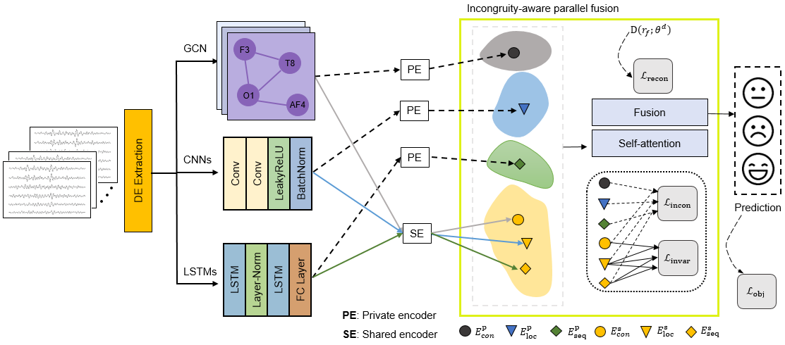

# COPA

Official implementation of the paper [Shared-private representation learning of heterogeneous EEG features for emotion recognition](https://www.sciencedirect.com/science/article/pii/S1746809426024389?dgcid=coauthor&fbclid=IwY2xjawV0ZVlleHRuA2FlbQIxMQBwZG9mBXNydGMGYXBwX2lkEDIyMjAzOTE3ODgyMDA4OTIAAR8D3CWKPM1fkzxsUM9sROVehrz52wqhUBHpKqpd1nGXvvTDiH1unBB9njPfVA_aem_By1xmB35PMGMbosBrEiiqQ#d1e3749)

<p align="center">
   
</p>

### Data Download and set up environments

 - [SEED](https://bcmi.sjtu.edu.cn/home/seed/seed.html)
 - [SEED-IV](https://bcmi.sjtu.edu.cn/home/seed/seed-iv.html#)

Set the dataset-wise parameters as follows:

<table>
<tr>
    <th>Dataset</th>
      <th>num. classes</th>
    <td>dir_path</td>
  </tr>
<tr>
  <td>SEED </td>
  <td>3</td>
  <td>[root_folder]/SEED/ExtractedFeatures</td>
</tr>
  
<tr>
  <td>SEED-IV </td>
  <td>4</td>
  <td>[root_folder]/SEED-IV/eeg_feature_smooth</td>
</tr>
</table>

### Running the code
```
python main.py --n_classes [num. classes] --dataset_dir [dir_path] --in_channels 5 --num_electrodes 62 --model_name COPA
```

Optionally choose --exper-setting indep for subject-independent setting, the default dep is in the subject-dependent setting

### Citation

If this code is useful for your research, please cite us at:

```
@article{Kang2027COPA,
  title={Shared-private representation learning of heterogeneous EEG features for emotion recognition},
  author={Kang, Hyunwook and Lee, Young-Eun and Lee, Minji},
  journal={Biomedical Signal Processing and Control},
  year={2027}
}
```

### Contact

For any questions, please email at [hyunwook.kang@catholic.ac.kr](mailto:hyunwook.kang@catholic.ac.kr)
